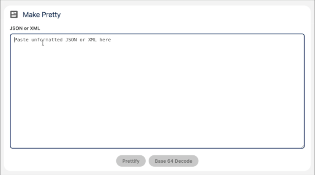

# Make Pretty

Make Pretty is a free, open source Salesforce LWC for reading messy data. Paste minified JSON or XML, or a Base64-encoded string, and Make Pretty formats it with clean indentation so you can actually read it. It's handy for inspecting API payloads, integration logs, platform event bodies, and anything else that arrives as one long line.

<p align="center">
  
</p>

## Features

- **Prettify JSON and XML.** Detects the format automatically and indents it consistently.
- **Decode Base64.** Turns a Base64 string back into readable text, ready to prettify.
- **Clear error messages.** Tells you when input isn't valid JSON, XML, or Base64, and where the parser stopped.
- **Runs entirely in your browser.** Nothing you paste is saved, logged, or sent anywhere, not even to Salesforce.
- **Place it anywhere.** Use the Make Pretty tab, or drop the component onto any App, Record, or Home page in Lightning App Builder.
- **Translatable.** All UI text comes from custom labels, and every label can be overridden per placement.

## Installation

### From the install link

| Org type | Link |
| --- | --- |
| Production or Developer Edition | `https://login.salesforce.com/packaging/installPackage.apexp?p0=04tgK000000QWAjQAO` |
| Sandbox | `https://test.salesforce.com/packaging/installPackage.apexp?p0=04tgK000000QWAjQAO` |

Or with the Salesforce CLI:

```sh
sf package install --package 04tgK000000QWAjQAO --target-org <your-org> --wait 10
```

### Grant access

The Make Pretty tab is hidden until users have the **Make Pretty Access** permission set:

```sh
sf org assign permset --name tpl_mp__Make_Pretty_Access --target-org <your-org>
```

Or in Setup, go to **Permission Sets → Make Pretty Access → Manage Assignments**.

## Usage

1. Open **Make Pretty** from the App Launcher.
2. Paste JSON, XML, or a Base64 string into the text area.
3. For Base64, click **Base 64 Decode** first.
4. Click **Prettify**.

### Lightning App Builder properties

When you add the component to an App, Record, or Home page, you can set:

| Property | Description |
| --- | --- |
| Hide Card Title | Hides the card heading and icon. |
| Card Title | Overrides the card heading. |
| Field Label | Overrides the text area label. |
| Placeholder Text | Overrides the text area placeholder. |
| Prettify Button Label | Overrides the Prettify button text. |
| Decode Button Label | Overrides the Base 64 Decode button text. |

Leave any property blank to use the default, translated text.

## What's in the package

| Component | Type |
| --- | --- |
| `makePretty` | Lightning Web Component |
| `Make_Pretty` | Custom Tab |
| `Make_Pretty_Access` | Permission Set |
| `MakePretty_*` (9) | Custom Labels |

The package contains no Apex, no Visualforce, no third-party libraries, and makes no network callouts. Namespace: `tpl_mp`.

## Security

Make Pretty parses input in the browser using the standard `JSON.parse`, `DOMParser`, and `atob` APIs, and writes the result back into the text area through normal LWC data binding. No data leaves the page.

## Development

### Prerequisites

- [Salesforce CLI](https://developer.salesforce.com/tools/salesforcecli)
- Node.js and npm, for linting and formatting

### Set up

```sh
npm install
```

### Try it in a scratch org

```sh
sf org create scratch --definition-file config/project-scratch-def.json --alias make-pretty --no-namespace --duration-days 7
sf project deploy start --manifest manifest/package.xml --target-org make-pretty
sf org assign permset --name Make_Pretty_Access --target-org make-pretty
sf org open --target-org make-pretty
```

### Lint and format

```sh
npm run lint
npm run prettier
```

### Run the security scan

```sh
sf code-analyzer run --workspace . --rule-selector Recommended --rule-selector AppExchange --output-file assets/code-analyzer-report.html
```

### Project structure

```
force-app/main/default/
├── labels/          Custom labels for all UI text
├── lwc/makePretty/  The component
├── permissionsets/  Make Pretty Access
└── tabs/            Make Pretty tab
manifest/package.xml Deployment manifest
```

## Contributing

Issues and pull requests are welcome. Please run `npm run lint` and the Code Analyzer scan before opening a pull request, and keep all user-facing text in custom labels.

## License

Make Pretty is released under the [MIT License](LICENSE).
